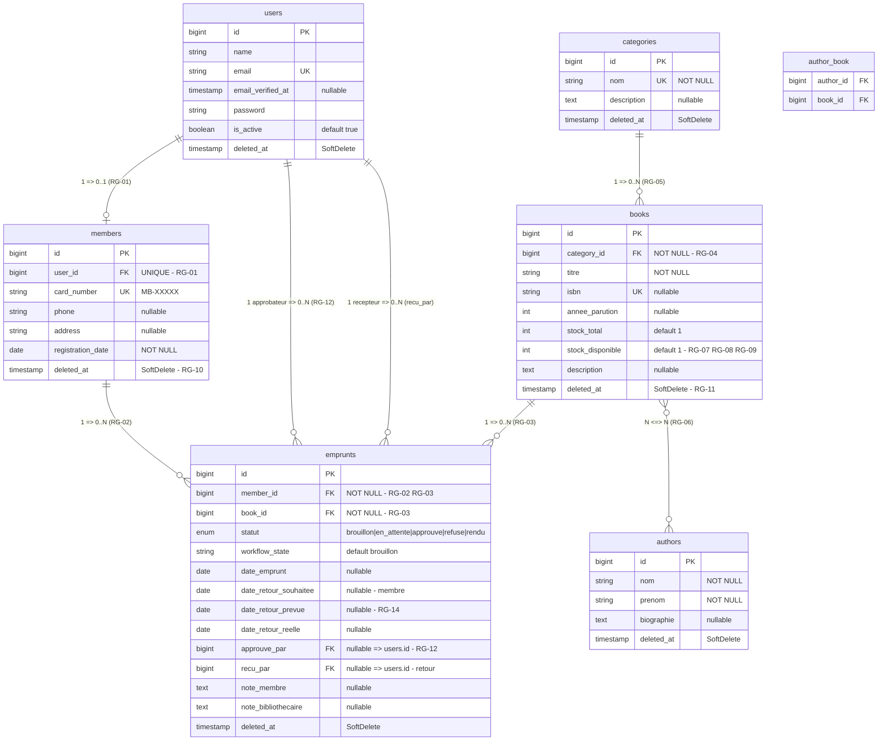

# Mini Bibliothèque — Documentation complète

> Application de gestion de bibliothèque : des membres empruntent des livres,
> un bibliothécaire valide les retours, chaque emprunt passe par un workflow
> d'approbation. Projet d'apprentissage reprenant les patterns de Easy Day-O.

---

## Sommaire

- [Stack technique](#stack-technique)
- [Structure des modules](#structure-des-modules)
- [Modèle de données](#modèle-de-données)
- [Règles de gestion](#règles-de-gestion)
- [Diagramme UML](#diagramme-uml)
- [Relations Eloquent](#relations-eloquent)
- [Workflow des emprunts (Symfony Workflow)](#workflow-des-emprunts-symfony-workflow)
- [Rôles et permissions (Spatie)](#rôles-et-permissions-spatie)
- [Authentification (Breeze)](#authentification-breeze)
- [Composants Livewire](#composants-livewire)
- [Emails](#emails)
- [SoftDeletes](#softdeletes)
- [État d'avancement](#état-davancement)
- [Ordre d'implémentation](#ordre-dimplémentation)
- Playbooks auth : [docs/README.md](./docs/README.md)
- Playbook workflow Emprunt : [docs/07-feat-module-emprunt-workflow.md](./docs/07-feat-module-emprunt-workflow.md)

---

## Stack technique

Starter kit officiel **Laravel 13 + Livewire**. Auth : Breeze **Livewire** (pas Blade).

### Installé

| Package | Version | Rôle |
|---------|---------|------|
| PHP | ^8.3 | Runtime |
| `laravel/framework` | ^13.17 | Framework principal |
| `laravel/breeze` | ^2.4 (dev) | Scaffolding auth (à installer avec `breeze:install livewire`) |
| `livewire/livewire` | ^3.6.4 | Composants réactifs (tout le projet) |
| `livewire/volt` | ^1.7 | Pages auth Breeze (composants Volt) |
| `livewire/blaze` | ^1.0 | Compilation / perf Livewire |
| `nwidart/laravel-modules` | ^13.0 | Architecture modulaire (`Modules/`) |
| `spatie/laravel-permission` | ^8.3 | Rôles et permissions |
| `guzzlehttp/guzzle` | ^8.0 (via Laravel) | HTTP client (dépendance du framework) |
| Vite | ^8.0 | Bundler front |
| Tailwind CSS | ^4.x | Styles |

### Prévu plus tard (pas encore dans `composer.json`)

| Package | Version visée | Rôle | Note |
|---------|---------------|------|------|
| `anhskohbo/no-captcha` | ^3.8 | reCAPTCHA sur le login | Conflit avec Guzzle 8 (`no-captcha` exige Guzzle ^6\|^7). À installer plus tard en pinant Guzzle `^7.9`, ou valider reCAPTCHA via `Http`. |
| `laravel/reverb` | ^1.0 | WebSockets temps réel | Dashboard / stock live |

### Installé (workflow)

| Package | Version | Rôle |
|---------|---------|------|
| `symfony/workflow` | ^7.4 | Machine à états des emprunts |

---

## Convention de nommage

Le projet mélange **tables SQL en anglais** et **libellés métier souvent en français** (colonnes Biblio).

| Couche | Exemple |
|--------|---------|
| Tables | `users`, `members`, `emprunts`, `books`, `authors`, `categories` |
| Modèles | `User`, `Member`, `Emprunt`, `Book`, `Author`, `Category` |
| Profil membre | Données identité sur `User` (`name`, `email`) ; données bibliothèque sur `Member` (`card_number`, `phone`, …) |

---

## Structure des modules

```
app/
  Models/
    User.php                        ← hasOne Member, empruntsApprouves(), HasRoles (Spatie)
  Events/
    EmpruntSoumis.php               ← broadcast → canal 'bibliothecaire' (à créer)
    EmpruntApprouve.php             ← broadcast → canal 'membre.{id}' (à créer)
    EmpruntRefuse.php               ← broadcast → canal 'membre.{id}' (à créer)
    StockMisAJour.php               ← broadcast → canal public 'livres' (à créer)
  Mail/
    BienvenueMail.php               ← envoyé à l'inscription (à créer)
    EmpruntApprouveMail.php         ← envoyé au membre à l'approbation (à créer)
    EmpruntRefuseMail.php           ← envoyé au membre au refus (à créer)
    RappelRetardMail.php            ← envoyé par le scheduler (à créer)
  Observers/
    EmpruntObserver.php             ← déclenche Events + Mails selon statut (à créer)
    MemberObserver.php              ← crée Member + card_number + email Bienvenue (à créer)
  Console/
    Commands/
      CheckRetardsCommand.php       ← commande schedulée quotidienne (à créer)

Modules/
  Biblio/                           ← Gestion du catalogue
    app/
      Models/
        Author.php
        Category.php
        Book.php
      Livewire/
        BookList.php                ← liste paginée + recherche wire:model.live
        BookForm.php                ← ajout / édition (modal)
        AuthorForm.php
        CategoryForm.php
      Http/Controllers/
        BiblioController.php        ← mince, return view uniquement
      Providers/
        BiblioServiceProvider.php   ← enregistrement Livewire::component(...)
      routes/
        web.php
    database/
      migrations/
        create_categories_table.php
        create_authors_table.php
        create_books_table.php
        create_author_book_table.php
      seeders/
        BiblioSeeder.php

  Emprunt/                          ← Gestion des emprunts + workflow
    app/
      Models/
        Member.php                  ← profil bibliothèque (identité via User)
        Emprunt.php
      Enums/
        StatutEmprunt.php           ← brouillon, en_attente, approuve, refuse, rendu ✅
      Services/
        EmpruntWorkflowService.php  ← transitions + RG + stock ✅
      Livewire/
        MemberList / MemberForm / MemberShow   ✅
        MesEmprunts.php             ← emprunts du membre connecté ✅
        EmpruntForm.php             ← brouillon + soumission ✅
        EmpruntList.php             ← tous les emprunts (admin/biblio) ✅
        EmpruntShow / EmpruntShowAdmin         ✅
        EmpruntApprove.php          ← approbation ✅
        TableauDeBord.php           ← stats (à créer)
      Http/Controllers/
        EmpruntController.php / MemberController.php
      Providers/
        EmpruntServiceProvider.php  ← binding workflow Symfony ✅
      routes/
        web.php
    database/
      migrations/
        2026_09_01_…_create_members_table.php                              ✅
        2026_09_01_…_create_emprunts_table.php                             ✅
        2026_09_08_…_add_date_retour_souhaitee_to_emprunts_table.php       ✅
        2026_09_10_…_rename_note_bibliothecaire_and_add_recu_par_….php     ✅
      seeders/
        EmpruntDatabaseSeeder.php

config/
  workflow.php                      ← state machine emprunt ✅
```

---

## Modèle de données

### `users`
| Colonne | Type | Contrainte |
|---------|------|------------|
| `id` | bigint | PK |
| `name` | string | NOT NULL |
| `email` | string | UNIQUE NOT NULL |
| `email_verified_at` | timestamp | nullable |
| `password` | string | NOT NULL |
| `remember_token` | string | nullable |
| `is_active` | boolean | default `true` |
| `deleted_at` | timestamp | SoftDelete |
| `created_at` / `updated_at` | timestamp | — |

### `members`

Profil **bibliothèque** lié à un `User`. L'identité (`name`, `email`) reste sur `users` — pas de duplication `nom` / `prenom`.

| Colonne | Type | Contrainte |
|---------|------|------------|
| `id` | bigint | PK |
| `user_id` | bigint | FK → `users.id`, UNIQUE (RG-01), cascade on hard delete |
| `card_number` | string | UNIQUE (ex. `MB-00001`) |
| `phone` | string | UNIQUE, nullable |
| `address` | string | nullable |
| `registration_date` | date | NOT NULL |
| `deleted_at` | timestamp | SoftDelete |
| `created_at` / `updated_at` | timestamp | — |

### `categories`
| Colonne | Type | Contrainte |
|---------|------|------------|
| `id` | bigint | PK |
| `nom` | string | UNIQUE NOT NULL |
| `description` | text | nullable |
| `deleted_at` | timestamp | SoftDelete |
| `created_at` / `updated_at` | timestamp | — |

### `authors`

Table SQL `authors` — modèle `Author`.

| Colonne | Type | Contrainte |
|---------|------|------------|
| `id` | bigint | PK |
| `nom` | string | NOT NULL |
| `prenom` | string | NOT NULL |
| `biographie` | text | nullable |
| `deleted_at` | timestamp | SoftDelete |
| `created_at` / `updated_at` | timestamp | — |

### `books`

Table SQL `books` — modèle `Book`. FK `category_id` → `categories.id`.

| Colonne | Type | Contrainte |
|---------|------|------------|
| `id` | bigint | PK |
| `category_id` | bigint | FK → `categories.id` NOT NULL |
| `titre` | string | NOT NULL |
| `isbn` | string | UNIQUE nullable |
| `annee_parution` | integer | nullable |
| `stock_total` | integer | default `1` |
| `stock_disponible` | integer | default `1` |
| `description` | text | nullable |
| `deleted_at` | timestamp | SoftDelete |
| `created_at` / `updated_at` | timestamp | — |

### `author_book` *(pivot N-N)*

| Colonne | Type | Contrainte |
|---------|------|------------|
| `author_id` | bigint | FK → `authors.id` |
| `book_id` | bigint | FK → `books.id` |

### `emprunts`

Schéma **final** (création + migrations de suivi).

| Colonne | Type | Contrainte / notes |
|---------|------|--------------------|
| `id` | bigint | PK |
| `member_id` | bigint | FK → `members.id` NOT NULL, restrict on delete |
| `book_id` | bigint | FK → `books.id` NOT NULL, restrict on delete |
| `statut` | enum | `brouillon\|en_attente\|approuve\|refuse\|rendu` — cast `StatutEmprunt` |
| `workflow_state` | string | default `'brouillon'` — marking Symfony Workflow |
| `date_emprunt` | date | nullable — fixée à l'approbation |
| `date_retour_souhaitee` | date | nullable — saisie par le membre à la demande *(migration 2026-09-08)* |
| `date_retour_prevue` | date | nullable — +14 j à l'approbation (RG-14) |
| `date_retour_reelle` | date | nullable — fixée au retour (`rendre`) |
| `approuve_par` | bigint | FK → `users.id` nullable — bibliothécaire qui approuve |
| `note_membre` | text | nullable |
| `note_bibliothecaire` | text | nullable — renommée depuis `note_bibliotécaire` *(migration 2026-09-10)* |
| `recu_par` | bigint | FK → `users.id` nullable — qui a validé le retour *(migration 2026-09-10)* |
| `deleted_at` | timestamp | SoftDelete |
| `created_at` / `updated_at` | timestamp | — |

#### Historique des migrations Emprunt

| Fichier | Action |
|---------|--------|
| `2026_09_01_110118_create_members_table` | Crée `members` |
| `2026_09_01_110132_create_emprunts_table` | Crée `emprunts` (schéma initial) |
| `2026_09_08_111200_add_date_retour_souhaitee_to_emprunts_table` | Ajoute `date_retour_souhaitee` |
| `2026_09_10_111024_rename_note_bibliothecaire_and_add_recu_par_to_emprunts_table` | Renomme `note_bibliotécaire` → `note_bibliothecaire`, ajoute `recu_par` |

---

## Règles de gestion

| Code | Règle |
|------|-------|
| **RG-01** | Un `User` possède **au plus un** `Member` (création automatique à l'inscription via `MemberObserver`) |
| **RG-02** | Un `Member` peut avoir **zéro ou plusieurs** `Emprunts` |
| **RG-03** | Un `Emprunt` concerne **exactement un** `Book` et **exactement un** `Member` |
| **RG-04** | Un `Book` appartient **obligatoirement** à **une seule** `Category` |
| **RG-05** | Une `Category` peut contenir **zéro ou plusieurs** `Books` |
| **RG-06** | Un `Book` peut avoir **un ou plusieurs** `Authors` ; un `Author` peut avoir **un ou plusieurs** `Books` (N-N via pivot `author_book`) |
| **RG-07** | Le `stock_disponible` d'un `Book` **diminue de 1** à chaque emprunt approuvé |
| **RG-08** | Le `stock_disponible` **augmente de 1** quand l'emprunt passe à l'état `rendu` |
| **RG-09** | Un emprunt ne peut être soumis (`demander`) que si `stock_disponible > 0` |
| **RG-10** | Un membre inactif ne peut plus emprunter : `Member` ou `User` soft-deleted, ou `User.is_active = false` |
| **RG-11** | Un `Book` soft-deleted ne peut plus faire l'objet d'un nouvel emprunt |
| **RG-12** | Seul un `BIBLIOTHECAIRE` ou `ADMIN` peut approuver / refuser / valider le retour |
| **RG-13** | Seul le `Member` propriétaire peut annuler un emprunt en état `en_attente` |
| **RG-14** | La `date_retour_prevue` est fixée à **+14 jours** depuis `date_emprunt` |
| **RG-15** | Un emprunt est **en retard** si `date_retour_prevue < aujourd'hui` et `statut = approuve` |

---

## Diagramme UML



### Cardinalités récapitulées

```
users          1 ──────────── 0..1   members
members        1 ──────────── 0..*   emprunts
books          1 ──────────── 0..*   emprunts
categories     1 ──────────── 0..*   books
books        0..* ──────────── 0..*  authors   (via author_book)
users          1 ──────────── 0..*   emprunts  (approbateur, clé approuve_par)
users          1 ──────────── 0..*   emprunts  (récepteur retour, clé recu_par)
```

---

## Relations Eloquent

| Modèle | Méthode | Type | Vers |
|--------|---------|------|------|
| `User` | `member()` | `hasOne` | `Member` |
| `User` | `empruntsApprouves()` | `hasMany` | `Emprunt` (clé `approuve_par`) |
| `User` | `empruntsRecues()` | `hasMany` | `Emprunt` (clé `recu_par`) |
| `Member` | `user()` | `belongsTo` | `User` |
| `Member` | `emprunts()` | `hasMany` | `Emprunt` |
| `Emprunt` | `member()` | `belongsTo` | `Member` |
| `Emprunt` | `book()` | `belongsTo` | `Book` |
| `Emprunt` | `approbateur()` | `belongsTo` | `User` (clé `approuve_par`) |
| `Emprunt` | `recepteur()` | `belongsTo` | `User` (clé `recu_par`) |
| `Book` | `emprunts()` | `hasMany` | `Emprunt` |
| `Book` | `category()` | `belongsTo` | `Category` |
| `Book` | `authors()` | `belongsToMany` | `Author` (pivot `author_book`) |
| `Category` | `books()` | `hasMany` | `Book` |
| `Author` | `books()` | `belongsToMany` | `Book` (pivot `author_book`) |

---

## Workflow des emprunts (Symfony Workflow)

> **Playbook détaillé :** [docs/07-feat-module-emprunt-workflow.md](./docs/07-feat-module-emprunt-workflow.md)

Chaque emprunt est une **state machine** : seules les transitions définies sont autorisées. Symfony Workflow valide les états ; le service métier applique les RG (stock, dates, permissions).

### États (`StatutEmprunt`)

| Valeur | Description |
|--------|-------------|
| `brouillon` | Demande créée, pas encore soumise |
| `en_attente` | Soumise, en attente d'approbation bibliothécaire |
| `approuve` | Validée, livre retiré du stock |
| `refuse` | Refusée par le bibliothécaire |
| `rendu` | Livre rendu, stock réincrémenté (état terminal) |

### Diagramme

```
                  ┌─────────────┐
     [MEMBRE]     │  brouillon  │ ◄─── annuler (RG-13)
                  └──────┬──────┘
                         │ demander
                         ▼
                  ┌─────────────┐
                  │ en_attente  │
                  └──┬──────┬───┘
        approuver    │      │  refuser
       [BIBLIO/ADMIN]│      │  [BIBLIO/ADMIN]
                     ▼      ▼
              ┌─────────┐ ┌────────┐
              │ approuve│ │ refuse │
              └────┬────┘ └────────┘
                   │ rendre
                   │ [BIBLIO/ADMIN]
                   ▼
              ┌─────────┐
              │  rendu  │
              └─────────┘
```

### Transitions

| Transition | De | Vers | Permission Spatie | Acteur |
|------------|-----|------|-------------------|--------|
| `demander` | brouillon | en_attente | `créer-emprunt` | MEMBRE |
| `approuver` | en_attente | approuve | `approuver-emprunt` | BIBLIOTHECAIRE, ADMIN |
| `refuser` | en_attente | refuse | `refuser-emprunt` | BIBLIOTHECAIRE, ADMIN |
| `rendre` | approuve | rendu | `valider-retour` | BIBLIOTHECAIRE, ADMIN |
| `annuler` | en_attente | brouillon | `annuler-emprunt` | MEMBRE (propriétaire, RG-13) |

### Effets métier par transition

| Transition | Effets (dans `EmpruntWorkflowService`, transaction DB) |
|------------|--------------------------------------------------------|
| `demander` | Vérifier stock (RG-09), membre actif (RG-10), livre non supprimé (RG-11) |
| `approuver` | `stock_disponible--` (RG-07), `date_emprunt`, `date_retour_prevue` +14j (RG-14), `approuve_par` |
| `refuser` | Optionnel : `note_bibliotécaire`, `approuve_par` |
| `rendre` | `stock_disponible++` (RG-08), `date_retour_reelle` |
| `annuler` | Vérifier propriétaire (RG-13) |

### `statut` vs `workflow_state`

| Colonne | Rôle |
|---------|------|
| `workflow_state` | Marking Symfony (`getWorkflowState()` / `setWorkflowState()`) |
| `statut` | Valeur métier castée en enum `StatutEmprunt` (UI, requêtes, observers) |

Les deux colonnes sont **synchronisées** dans `Emprunt::setWorkflowState()` — ne jamais les modifier directement depuis Livewire.

### Architecture

```
Livewire (EmpruntForm / EmpruntList)
        ↓
EmpruntWorkflowService     ← Spatie + RG + stock + dates
        ↓
Symfony Workflow           ← can() / apply()
        ↓
Emprunt::save()
        ↓
EmpruntObserver            ← mails, events Reverb
```

### Fichiers workflow

| Fichier | Statut |
|---------|--------|
| `Modules/Emprunt/app/Enums/StatutEmprunt.php` | ✅ |
| `Modules/Emprunt/app/Models/Emprunt.php` (getters/setters) | ✅ |
| `config/workflow.php` | ✅ |
| `EmpruntServiceProvider` (binding DI) | ✅ |
| `Modules/Emprunt/app/Services/EmpruntWorkflowService.php` | ✅ |
| `symfony/workflow` dans `composer.json` | ✅ (^7.4) |

---

## Rôles et permissions (Spatie)

| Rôle | Permissions |
|------|-------------|
| `ADMIN` | Toutes les permissions |
| `BIBLIOTHECAIRE` | `voir-livres`, `gérer-livres`, `gérer-emprunts`, `approuver-emprunt`, `refuser-emprunt`, `valider-retour`, `voir-membres`, `gérer-membres` |
| `MEMBRE` | `voir-livres`, `créer-emprunt`, `voir-mes-emprunts`, `annuler-emprunt` |

---

## Authentification (Breeze)

Auth **Livewire Volt** (`resources/views/livewire/pages/auth/`), layout `layouts.auth`. Détail branche par branche : [docs/README.md](./docs/README.md).

| Fonctionnalité | Route | Nom |
|----------------|-------|-----|
| Connexion + remember | `GET /login` | `login` |
| Inscription | `GET /register` | `register` |
| Vérification email | `GET /verify-email` | `verification.notice` |
| Mot de passe oublié | `GET /forgot-password` | `password.request` |
| Réinitialisation MDP | `GET /reset-password/{token}` | `password.reset` |
| Confirmation MDP (connecté) | `GET /confirm-password` | `password.confirm` |

reCAPTCHA et SSO Microsoft **pas** installés. Les soumissions passent par Livewire (`wire:submit`), pas par des contrôleurs Breeze Blade.

### Flow inscription → profil membre

```
1. /register → saisit nom, email, password
2. Email de vérification envoyé (Breeze natif)
3. Rôle MEMBRE assigné (Spatie) — ✅ fait dans register Volt
4. MemberObserver::created() (à créer)
   → Member créé (card_number: MB-00001, registration_date)
   → Email BienvenueMail envoyé
5. Clic sur lien → email vérifié
6. Redirigé vers /dashboard
```

---

## Composants Livewire

### Module Biblio

| Composant | Fichier | Fonctionnalités |
|-----------|---------|-----------------|
| `LivreList` | `Biblio/app/Livewire/LivreList.php` | Liste paginée, recherche `wire:model.live`, filtre par catégorie, stock en temps réel (Reverb) |
| `LivreForm` | `Biblio/app/Livewire/LivreForm.php` | Modal création/édition, `wire:submit.prevent="save"`, sélection auteurs multiple |
| `AuteurForm` | `Biblio/app/Livewire/AuteurForm.php` | Ajout/édition auteur |
| `CategorieForm` | `Biblio/app/Livewire/CategorieForm.php` | Ajout/édition catégorie |

### Module Emprunt

| Composant | Fichier | Fonctionnalités |
|-----------|---------|-----------------|
| `EmpruntList` | `Emprunt/app/Livewire/EmpruntList.php` | Mes emprunts (membre) ou tous (admin/biblio), filtre par statut, badge retard |
| `EmpruntForm` | `Emprunt/app/Livewire/EmpruntForm.php` | Choisir un livre disponible + soumettre demande, validation RG-09 |
| `TableauDeBord` | `Emprunt/app/Livewire/TableauDeBord.php` | Stats (livres dispo, emprunts en attente, retards), mise à jour temps réel via Reverb |

---

## Emails

| Classe Mail | Déclencheur | Destinataire |
|-------------|-------------|--------------|
| `BienvenueMail` | `MembreObserver::created()` | Nouveau membre |
| `EmpruntSoumisNotif` | `EmpruntObserver::created()` | Bibliothécaire |
| `EmpruntApprouveMail` | `EmpruntObserver::updated()` statut → approuve | Membre |
| `EmpruntRefuseMail` | `EmpruntObserver::updated()` statut → refuse | Membre |
| `RappelRetardMail` | `CheckRetardsCommand` (scheduler quotidien) | Membres en retard |

### Configuration Mailtrap (développement)

```env
MAIL_MAILER=smtp
MAIL_HOST=sandbox.smtp.mailtrap.io
MAIL_PORT=2525
MAIL_USERNAME=xxxxxx
MAIL_PASSWORD=xxxxxx
MAIL_FROM_ADDRESS="noreply@mini-biblio.local"
MAIL_FROM_NAME="Mini Bibliothèque"
```

---

## Reverb (WebSockets temps réel)

| Événement | Canal | Type | Qui écoute |
|-----------|-------|------|------------|
| `EmpruntSoumis` | `bibliothecaire` | Privé | Dashboard bibliothécaire |
| `EmpruntApprouve` | `membre.{id}` | Privé | Page "mes emprunts" du membre |
| `EmpruntRefuse` | `membre.{id}` | Privé | Page "mes emprunts" du membre |
| `StockMisAJour` | `livres` | Public | Liste des livres |

### Écoute dans Livewire

```php
// TableauDeBord.php — côté bibliothécaire
#[On('echo:bibliothecaire,EmpruntSoumis')]
public function rafraichirDemandes(): void
{
    $this->chargerDemandes();
}

// EmpruntList.php — côté membre
#[On('echo-private:membre.{membreId},EmpruntApprouve')]
public function notifierApprobation(): void
{
    $this->dispatch('notify', message: 'Votre emprunt a été approuvé !');
}
```

### Configuration `.env`

```env
REVERB_APP_ID=mini-biblio
REVERB_APP_KEY=xxxxxx
REVERB_APP_SECRET=xxxxxx
REVERB_HOST=localhost
REVERB_PORT=8080
REVERB_SCHEME=http

BROADCAST_CONNECTION=reverb
```

---

## SoftDeletes

`SoftDeletes` est activé sur : `users`, `membres`, `livres`, `categories`, `auteurs`, `emprunts`.

**Non utilisé sur** : `auteur_livre` (pivot), tables Spatie.

| Opération | Méthode |
|-----------|---------|
| Suppression douce | `$model->delete()` |
| Inclure supprimés | `Model::withTrashed()->get()` |
| Uniquement supprimés | `Model::onlyTrashed()->get()` |
| Restaurer | `$model->restore()` |
| Suppression définitive | `$model->forceDelete()` |

---

## État d'avancement

Dernière mise à jour : **2026-09-10**.

### Auth & socle ✅

| Élément | Statut |
|---------|--------|
| Breeze Livewire + Volt | ✅ |
| Spatie rôles / permissions | ✅ |
| `User` : SoftDeletes, `is_active`, HasRoles | ✅ |
| i18n auth (FR/EN) | ✅ |
| Inscription + rôle MEMBRE | ✅ |
| Layout sidebar + `@can(...)` | ✅ |

### Module Biblio ✅

| Élément | Statut |
|---------|--------|
| Migrations (`books`, `authors`, `categories`, pivot) | ✅ |
| Modèles + relations | ✅ |
| Livewire listes / formulaires / détails | ✅ |

### Module Emprunt 🟡 (cœur métier quasi terminé)

| Élément | Statut |
|---------|--------|
| Migrations `members`, `emprunts` | ✅ |
| Migration `date_retour_souhaitee` (2026-09-08) | ✅ |
| Migration `note_bibliothecaire` + `recu_par` (2026-09-10) | ✅ |
| Modèles `Member`, `Emprunt` + relations | ✅ |
| Enum `StatutEmprunt` + sync workflow | ✅ |
| Symfony Workflow (`config`, provider, service) | ✅ |
| Livewire membres (`MemberList/Form/Show`) | ✅ |
| Livewire `MesEmprunts` + `EmpruntForm` | ✅ |
| Livewire admin (`EmpruntList`, Show, Approve) | ✅ |
| Transitions `demander` / `approuver` / `annuler` / `rendre` | ✅ |
| Transition `refuser` (UI) | ⬜ bouton pas encore branché |
| i18n module Emprunt (FR/EN) | ✅ |
| Observers + Mails métier | ⬜ |
| `TableauDeBord` | ⬜ |
| Reverb temps réel | ⬜ |
| reCAPTCHA login | ⬜ |

**Tu es ici :** fin de l’**étape 4** (module Emprunt + workflow opérationnel).  
**Prochaine étape logique :** UI refus (`refuser`), puis **étape 5** (Observers + mails), ou polish / seeders.

---

## Ordre d'implémentation

### Étape 1 — Socle
1. `laravel new mini-biblio`
2. Installer les packages (`composer require`, `npm install`)
3. Configurer `.env` (DB, Mail ; reCAPTCHA / Reverb plus tard)
4. `php artisan breeze:install livewire --pest` (pas la stack Blade)
5. `php artisan migrate`

### Étape 2 — Spatie + rôles
6. `php artisan vendor:publish --provider="Spatie\Permission\PermissionServiceProvider"`
7. Créer `RolesPermissionsSeeder` (ADMIN, BIBLIOTHECAIRE, MEMBRE + permissions)
8. Ajouter `HasRoles` dans `User.php`

### Étape 3 — Module Biblio
9. `php artisan module:make Biblio`
10. Migrations : `categories`, `auteurs`, `livres`, pivot `auteur_livre`
11. Modèles + relations (`belongsTo`, `hasMany`, `belongsToMany`)
12. `BiblioController` (mince)
13. Livewire `LivreList` + `LivreForm`
14. Enregistrement dans `BiblioServiceProvider`

### Étape 4 — Module Emprunt ✅ (presque complète)
15. `php artisan module:make Emprunt` ✅
16. Migrations : `members`, `emprunts` + suivis (`date_retour_souhaitee`, `recu_par`, rename note) ✅
17. Modèles + relations + enum `StatutEmprunt` ✅
18. `composer require symfony/workflow` ✅
19. `config/workflow.php` — transitions ✅
20. `EmpruntWorkflowService` — RG + stock + permissions ✅
21. Livewire membres / mes emprunts / liste admin / approve / retour ✅
22. Enregistrement workflow dans `EmpruntServiceProvider` ✅
23. UI transition `refuser` ⬜
24. `TableauDeBord` ⬜

> Détail : [docs/07-feat-module-emprunt-workflow.md](./docs/07-feat-module-emprunt-workflow.md)

### Étape 5 — Observers + Mail ⬜
25. `MemberObserver` (création profil + card_number + email Bienvenue)
26. `EmpruntObserver` (events Reverb + emails selon transition)
27. Classes `Mailable` + templates Blade email
28. `CheckRetardsCommand` + `scheduler`

### Étape 6 — Reverb ⬜
29. `php artisan reverb:install`
30. Créer les `Event` broadcastables
31. Brancher `#[On('echo:...')]` dans les composants Livewire

### Étape 7 — Auth + reCAPTCHA ⬜
32. Modifier `login.blade.php` : ajouter `{!! NoCaptcha::display() !!}`
33. Modifier `AuthenticatedSessionController` : valider `g-recaptcha-response`
34. Ajouter `MustVerifyEmail` dans `User.php`

### Étape 8 — Finitions 🟡
35. Layout principal avec sidebar + `@can(...)` ✅
36. `@livewireStyles` / `@livewireScripts` dans le layout ✅
37. Seeders de données de test ⬜
38. Vérification des RG dans les composants Livewire 🟡
---

## Jour 1 — Module Auth complet

> Objectif : avoir une authentification 100% fonctionnelle avant de toucher aux modules métier.

### Prérequis

| Outil | Vérification |
|-------|-------------|
| PHP 8.2+ | `php -v` |
| Composer | `composer -V` |
| Node.js / npm | `node -v && npm -v` |
| MySQL ou SQLite | `mysql --version` |
| Compte [Mailtrap](https://mailtrap.io) | Gratuit — pour tester les emails |
| Compte [Google reCAPTCHA v2](https://www.google.com/recaptcha) | Gratuit — clé site + clé secrète |

---

### Plan d'exécution Jour 1

#### 1. Créer le projet Laravel

```bash
laravel new mini-biblio --no-interaction
cd mini-biblio
```

#### 2. Installer les packages

```bash
composer require \
  laravel/breeze \
  nwidart/laravel-modules \
  spatie/laravel-permission \
  livewire/livewire \
  anhskohbo/no-captcha \
  symfony/workflow \
  laravel/reverb

php artisan breeze:install blade
npm install && npm run build
```

#### 3. Configurer `.env`

```env
APP_NAME="Mini Bibliothèque"
APP_URL=http://localhost:8000

DB_CONNECTION=mysql
DB_HOST=127.0.0.1
DB_PORT=3306
DB_DATABASE=mini_biblio
DB_USERNAME=root
DB_PASSWORD=secret

MAIL_MAILER=smtp
MAIL_HOST=sandbox.smtp.mailtrap.io
MAIL_PORT=2525
MAIL_USERNAME=xxxxxx
MAIL_PASSWORD=xxxxxx
MAIL_FROM_ADDRESS="noreply@mini-biblio.local"
MAIL_FROM_NAME="Mini Bibliothèque"

NOCAPTCHA_SECRET=xxxxxx
NOCAPTCHA_SITEKEY=xxxxxx

REVERB_APP_ID=mini-biblio
REVERB_APP_KEY=xxxxxx
REVERB_APP_SECRET=xxxxxx
REVERB_HOST=localhost
REVERB_PORT=8080
REVERB_SCHEME=http

BROADCAST_CONNECTION=reverb
```

#### 4. Publier Spatie + migrer

```bash
php artisan vendor:publish --provider="Spatie\Permission\PermissionServiceProvider"
php artisan migrate
```

#### 5. Modifier `app/Models/User.php`

Ajouter les trois traits :

```php
use Illuminate\Contracts\Auth\MustVerifyEmail;
use Illuminate\Database\Eloquent\SoftDeletes;
use Spatie\Permission\Traits\HasRoles;

class User extends Authenticatable implements MustVerifyEmail
{
    use HasRoles, SoftDeletes;

    protected $fillable = ['name', 'email', 'password', 'is_active'];

    protected $casts = [
        'email_verified_at' => 'datetime',
        'password'          => 'hashed',
        'is_active'         => 'boolean',
        'deleted_at'        => 'datetime',
    ];

    public function membre(): \Illuminate\Database\Eloquent\Relations\HasOne
    {
        return $this->hasOne(\Modules\Emprunt\app\Models\Membre::class);
    }
}
```

#### 6. Créer la migration `membres`

```bash
php artisan module:make Emprunt
php artisan make:migration create_membres_table --path=Modules/Emprunt/database/migrations
```

```php
Schema::create('membres', function (Blueprint $table) {
    $table->id();
    $table->foreignId('user_id')->constrained()->cascadeOnDelete();
    $table->string('numero_carte')->unique();
    $table->string('nom');
    $table->string('prenom');
    $table->string('telephone')->nullable();
    $table->text('adresse')->nullable();
    $table->date('date_inscription');
    $table->boolean('est_actif')->default(true);
    $table->softDeletes();
    $table->timestamps();
});
```

#### 7. Créer le modèle `Membre`

```php
class Membre extends Model
{
    use SoftDeletes;

    protected $fillable = [
        'user_id', 'numero_carte', 'nom', 'prenom',
        'telephone', 'adresse', 'date_inscription', 'est_actif',
    ];

    protected $casts = [
        'date_inscription' => 'date',
        'est_actif'        => 'boolean',
    ];

    public function user(): BelongsTo
    {
        return $this->belongsTo(User::class);
    }

    public function emprunts(): HasMany
    {
        return $this->hasMany(Emprunt::class);
    }
}
```

#### 8. Créer `MembreObserver`

Déclenché automatiquement à chaque création de `User` :

```php
class MembreObserver
{
    public function created(User $user): void
    {
        $membre = Membre::create([
            'user_id'          => $user->id,
            'numero_carte'     => 'MB-' . str_pad($user->id, 5, '0', STR_PAD_LEFT),
            'nom'              => $user->name,
            'prenom'           => '',
            'date_inscription' => now(),
        ]);

        $user->assignRole('MEMBRE');

        Mail::to($user->email)->send(new BienvenueMail($user));
    }
}
```

Enregistrer dans `AppServiceProvider::boot()` :
```php
User::observe(MembreObserver::class);
```

#### 9. Créer `BienvenueMail`

```bash
php artisan make:mail BienvenueMail
```

Template Blade `resources/views/emails/bienvenue.blade.php` :
- Nom du membre
- Lien de connexion
- Rappel : vérifier l'email

#### 10. Créer `RolesPermissionsSeeder`

```php
$permissions = [
    'voir-livres', 'gérer-livres',
    'créer-emprunt', 'voir-mes-emprunts', 'annuler-emprunt',
    'gérer-emprunts', 'approuver-emprunt', 'refuser-emprunt', 'valider-retour',
    'voir-membres', 'gérer-membres',
];

foreach ($permissions as $perm) {
    Permission::firstOrCreate(['name' => $perm]);
}

$admin        = Role::firstOrCreate(['name' => 'ADMIN']);
$biblio       = Role::firstOrCreate(['name' => 'BIBLIOTHECAIRE']);
$membre       = Role::firstOrCreate(['name' => 'MEMBRE']);

$biblio->syncPermissions([
    'voir-livres', 'gérer-livres', 'gérer-emprunts',
    'approuver-emprunt', 'refuser-emprunt', 'valider-retour',
    'voir-membres', 'gérer-membres',
]);

$membre->syncPermissions([
    'voir-livres', 'créer-emprunt', 'voir-mes-emprunts', 'annuler-emprunt',
]);

$admin->syncPermissions(Permission::all());

// User admin de test
$userAdmin = User::firstOrCreate(
    ['email' => 'admin@mini-biblio.local'],
    ['name' => 'Administrateur', 'password' => bcrypt('password'), 'email_verified_at' => now()]
);
$userAdmin->assignRole('ADMIN');
```

#### 11. Ajouter reCAPTCHA sur le login

Dans `resources/views/auth/login.blade.php`, avant le bouton submit :

```html
<div class="mt-4">
    {!! NoCaptcha::display() !!}
    @error('g-recaptcha-response')
        <p class="text-sm text-red-600 mt-1">{{ $message }}</p>
    @enderror
</div>
```

Dans `AuthenticatedSessionController@store`, ajouter à la validation :

```php
'g-recaptcha-response' => ['required', 'captcha'],
```

Dans le layout, avant `</body>` :

```html
{!! NoCaptcha::renderJs() !!}
```

#### 12. Lancer et tester

```bash
php artisan db:seed --class=RolesPermissionsSeeder
php artisan serve
```

**Tests à effectuer :**
- [ ] Inscription → email de vérification reçu sur Mailtrap
- [ ] Clic sur lien → email vérifié → redirigé vers dashboard
- [ ] Profil `Membre` créé automatiquement (vérifier en DB)
- [ ] Rôle `MEMBRE` assigné (vérifier en DB)
- [ ] Email `BienvenueMail` reçu sur Mailtrap
- [ ] Login avec reCAPTCHA
- [ ] "Remember me" → cookie persistant
- [ ] Mot de passe oublié → email de reset reçu
- [ ] Réinitialisation du mot de passe fonctionnelle
- [ ] Login avec `admin@mini-biblio.local` / `password`
