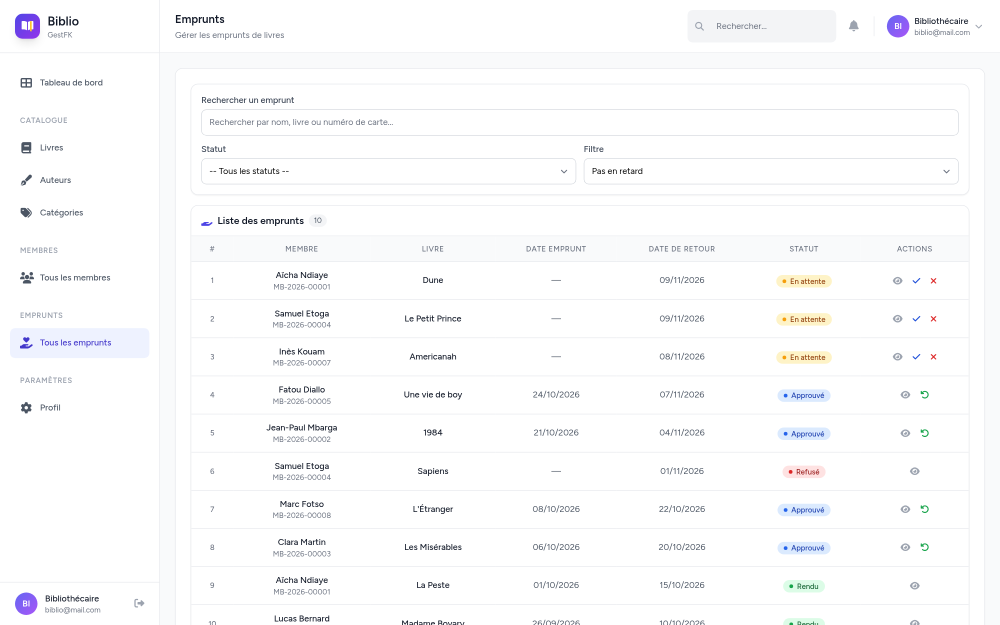

<p align="center">
  
</p>

<h1 align="center">Mini Biblio</h1>

<p align="center">
  Application de gestion de bibliothèque : catalogue, membres et emprunts, de la demande au retour.
</p>

<p align="center">
  <a href="https://github.com/fernand-kamdem/mini-biblio/actions/workflows/tests.yml"></a>
  
  
  
</p>



## Fonctionnalités

- **Membres** : parcourir le catalogue, demander un livre, suivre et annuler ses demandes.
- **Bibliothécaires** : gérer le catalogue et les membres, approuver ou refuser les demandes, enregistrer les retours.
- **Administrateurs** : tout cela, plus la gestion des bibliothécaires.

Chaque emprunt suit un parcours strict, le stock reste juste même quand deux approbations arrivent en même temps, et l'interface est disponible en français et en anglais. Chaque rôle arrive sur un tableau de bord calculé sur les données réelles : demandes en attente, retards, stock critique, emprunts en cours.

## Démonstration

Avec `DEMO_MODE=true` dans le `.env` :

- `php artisan migrate --seed` charge un catalogue de 20 titres, des membres et des emprunts fictifs (dont des retards) ;
- la page de connexion propose trois comptes de démonstration (membre, bibliothécaire, administrateur), qui ne peuvent être ni modifiés ni supprimés ;
- `php artisan demo:reset` remet tout à zéro. La commande est planifiée chaque nuit (`DEMO_RESET_AT`, 3 h par défaut) : ajoutez `php artisan schedule:run` aux tâches cron du serveur, chaque minute.

## Stack

Laravel 13, Livewire 3, Tailwind CSS, Spatie Permission, Symfony Workflow, PostgreSQL ou MySQL, Pest.

## Installation

Prérequis : PHP 8.3+, Composer, Node.js 20+ et une base PostgreSQL ou MySQL.

```bash
git clone https://github.com/fernand-kamdem/mini-biblio.git
cd mini-biblio
composer install
npm install
cp .env.example .env
php artisan key:generate
```

Dans `.env`, renseignez la connexion à la base (`DB_*`) et les mots de passe des comptes de base (`SEED_ADMIN_PASSWORD`, `SEED_BIBLIO_PASSWORD`), puis :

```bash
php artisan migrate --seed
composer dev
```

L'application répond sur [http://localhost:8000](http://localhost:8000). Les tests se lancent avec `composer test`.

## Licence

© 2026 Fernand Kamdem. Tous droits réservés : le code peut être consulté, mais pas réutilisé sans autorisation.
